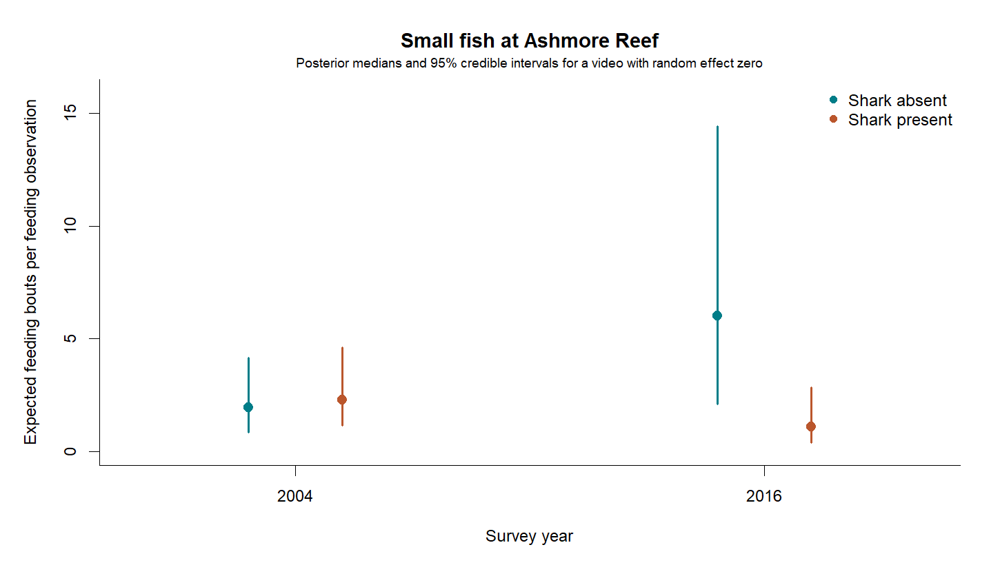
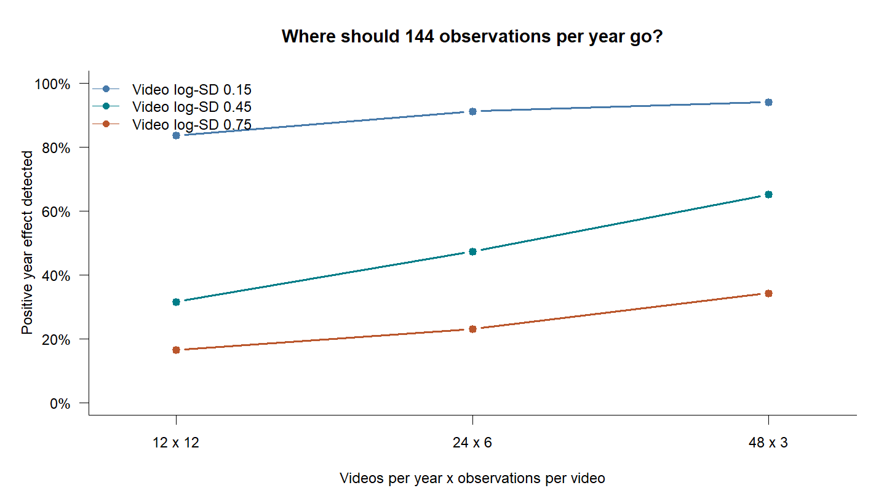
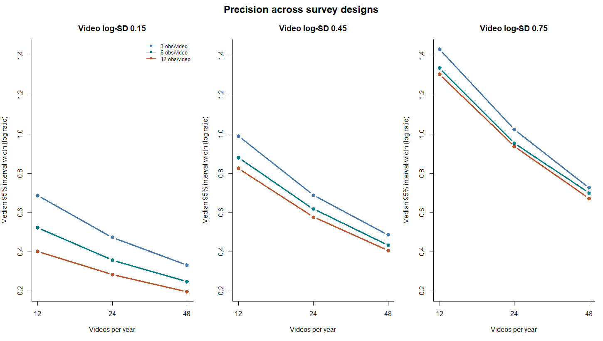

# Ashmore Reef BRUVs
## Feeding bouts and survey effort

This R project reproduces the small-fish feeding-bout analysis from Storm et al. (2025) and uses a simulation to test how to allocate observation effort across baited remote underwater video (BRUV) deployments.

**Published-data result.** In 2016, the estimated expected bout count per qualifying small-fish observation was about **82% lower** in videos with sharks present. The posterior median present-to-absent ratio was **0.18** (95% credible interval **0.05 to 0.73**). The 2004 ratio was **1.17** (95% credible interval **0.43 to 3.34**). The data are observational, and there were only 16 qualifying videos.



**Simulation result.** With 144 scored observations per year and moderate variation between videos, the 95% interval detected the simulated 35% increase in **32%** of datasets with 12 videos and 12 observations each, **47%** with 24 videos and six observations each, and **65%** with 48 videos and three observations each.

| Between-video variation (log SD) | 12 videos × 12 scores | 24 videos × 6 scores | 48 videos × 3 scores |
| --- | ---: | ---: | ---: |
| Low (0.15) | 84% | 91% | 94% |
| Moderate (0.45) | 32% | 47% | 65% |
| High (0.75) | 17% | 23% | 34% |



## Run in RStudio

Open [ashmore-bruv.Rproj](ashmore-bruv.Rproj). The completed outputs are included. To draw all three charts in the **Plots** pane immediately, run:

```r
source("show-plots.R")
```

Use the Plots pane arrows to see the posterior estimates, the equal-effort comparison, and the precision chart. To rebuild the results, run:

```r
source("run.R")
```

The main run uses base R. It downloads and caches two files from the pinned public repository on the first run. The GitHub mirror was used because the direct Dryad download returned HTTP 403. The authors' archived posterior is summarized directly, without compiling Stan. [refit.R](refit.R) provides an optional fresh Bayesian fit and requires brms, cmdstanr, and CmdStan. This optional script was syntax-checked and has not been executed.

## Reproducing the feeding-bout analysis

The analyzed sample includes observations of small fish with at least one bite and positive recorded feeding time. The project verifies the four input columns against the archived model data row by row. This gives 106 qualifying observations from 16 videos, from the study's 48 selected videos.

The authors used a Poisson log-link model with year, shark presence, their interaction, and a video random intercept. The project reconstructs the four response-scale expected values at a zero video random effect and their pairwise ratios from 8,000 archived draws. The displayed summaries use medians and equal-tail 95% credible intervals. The original plot used posterior modes and highest-density intervals. These estimates describe bouts among qualifying feeding observations. They do not measure how likely a fish was to feed or establish a causal effect of sharks.

## Simulating survey effort

The simulation sets expected counts to 2.0 in 2004 and 2.7 in 2016. Each video has its own lognormal multiplier, shared by all observations from that video. Independent Poisson variation is added within each video. The three video log standard deviations span low, moderate, and high clustering. For context, the archived model's posterior median video log-SD is 0.67 (95% interval 0.41 to 1.21).

There are 27 designs and 1,000 simulated datasets per design. Each year has 12, 24, or 48 videos with 3, 6, or 12 scored observations each. The simulation estimates a marginal year ratio using video means, with a Welch-style delta-method interval on the log scale. The analysis counts how often the 95% interval excludes 1 in the correct direction. The summary also reports bias, RMSE, coverage, interval width, and Monte Carlo error for detection probability.

The simulation isolates the year effect and holds shark-presence conditions fixed. A Poisson count can be zero, as allowed by the published likelihood. The scenarios assume independent deployments and a fixed number of scorable observations per video. Equal scoring effort can require different field effort. If deployments cost more than extra scoring, the best allocation can change.



## Project files

| File | Contents |
| --- | --- |
| [run.R](run.R) | Rebuilds the tables and charts |
| [R/reproduction.R](R/reproduction.R) | Input verification and archived posterior summaries |
| [R/simulation.R](R/simulation.R) | Clustered count simulation and survey-design comparison |
| [R/plots.R](R/plots.R) | Reusable chart functions |
| [results/bout-contrasts.csv](results/bout-contrasts.csv) | Four posterior contrasts |
| [results/observed-sample.csv](results/observed-sample.csv) | Sample sizes and raw group means |
| [results/simulation-summary.csv](results/simulation-summary.csv) | Results for all 27 survey designs |
| [results/simulation-replicates.csv](results/simulation-replicates.csv) | All 27,000 replicate estimates |

## Sources

Storm, Z., Meekan, M. G., Eich, A., Speed, C. W., Killen, S. S., & Lester, E. K. (2025). Recovery of reef shark populations invokes anti-predator behaviours in mesopredatory reef fishes on a coral reef. *Journal of Animal Ecology, 94*(5), 919–931. [Paper](https://doi.org/10.1111/1365-2656.70024) · [Dryad data](https://doi.org/10.5061/dryad.x95x69pvx) · [Authors' feeding-bout model code](https://github.com/andieich/Ashmore_behaviour/blob/03bbfc5e30f8fe64295c1d03c5598fefe2bbc82f/scripts/5_mod_boutsbites.qmd)

### Data and archived fit

Storm, Z., Meekan, M., Eich, A., Speed, C., Killen, S., & Lester, E. (2025). *Recovery of reef shark populations invokes anti-predator behaviours in mesopredatory reef fishes on a coral reef* [Data set]. Dryad. [10.5061/dryad.x95x69pvx](https://doi.org/10.5061/dryad.x95x69pvx)

The reproduction downloads the [cleaned data](https://github.com/andieich/Ashmore_behaviour/blob/03bbfc5e30f8fe64295c1d03c5598fefe2bbc82f/data/clean/clean_data.csv) and the [archived Bayesian fit](https://github.com/andieich/Ashmore_behaviour/blob/03bbfc5e30f8fe64295c1d03c5598fefe2bbc82f/models/fit_bouts_S.rds) from the authors' pinned repository revision.
